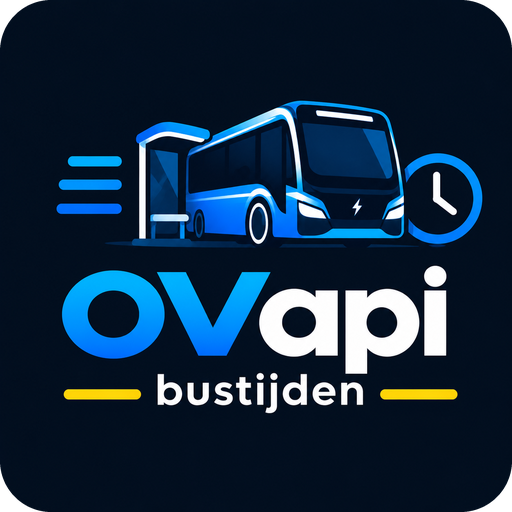

<p align="center"></p>

# OVapi bussen en halteinformatie

[](https://github.com/GruttePier013/OVapi-stops-and-timetables/actions/workflows/validate.yml)
[](https://my.home-assistant.io/redirect/hacs_repository/?owner=GruttePier013&repository=OVapi-stops-and-timetables&category=integration)

Live vertrektijden van bussen (en optioneel tram, metro en veerboot) in Nederland in Home Assistant, via [OVapi](https://v0.ovapi.nl). Je zoekt haltes op een kaart, kiest per rijrichting een halte en krijgt per halte sensoren, een kaartmarker en instellingen voor wanneer er ververst wordt.

## Installeren

1. HACS → ⋮ → **Aangepaste repositories** → voeg `https://github.com/GruttePier013/OVapi-stops-and-timetables` toe als **Integratie**.
2. Download **OVapi bussen en halteinformatie** en herstart Home Assistant.
3. Instellingen → Apparaten & services → **Integratie toevoegen** → *OVapi bussen en halteinformatie*.

Handmatig kan ook: kopieer `custom_components/ovapi_bustijden` naar `config/custom_components/` en herstart.

## Haltes toevoegen

1. Kies **Haltes zoeken** (of *TPC-codes invoeren* als je de OVapi-code al kent).
2. Typ een **plaats** (`Voorbeeldstad`) of **straat + plaats** (`Voorbeeldlaan Voorbeeldstad`) en druk op Enter. Verplaats de pin en pas de cirkel aan door aan de rand te slepen (50–5000 m). Tram, metro en veerboot kun je ook aanvinken.
3. Vink de haltes aan. Elke rijrichting is een eigen halte, met afstand tot huis en de huidige vertrektijden. De eerste keer wordt het haltebestand van [NDOV Loket](https://data.ndovloket.nl/haltes/) gedownload (±13 MB, met voortgang in %).
4. *Extra opties*: richting in de apparaatnaam (standaard aan), na hoeveel uur data als verouderd geldt (standaard 12) en het haltebestand opnieuw downloaden.
5. Per halte: naam, welke lijnen je wilt zien (leeg = alle) en eventueel alleen bepaalde bestemmingen (bijv. `Station, Noord`).

Later wijzig je alles via **Configureren** (haltes zoeken, bewerken, verwijderen, instellingen).

## Wat krijg je per halte?

**De belangrijkste entiteiten**

| Entiteit | Inhoud |
|---|---|
| Vertrektijden | `14:05 (Lijn 74)`, `Geen bussen` of `Data vernieuwen`; het attribuut `vertrekken` bevat tijd, lijn, bestemming, vertraging en minuten |
| Volgende vertrek | tijdstip van de eerstvolgende bus |
| Lijnen | `34, 73, 350` (of `Geen`) |
| Lijn 34, Lijn 73, … | volgende vertrek per lijn (optioneel, aan/uit in de instellingen) |
| Halte op kaart | de marker op de kaart, met de eerstvolgende bus als status |
| Personen nabij | de gevolgde personen die in de zone van de halte zijn |
| Vernieuwen (knop) | direct verversen |

**Instellingen per halte** (schakelaars en keuzelijsten op het apparaat)

| Instelling | Betekenis |
|---|---|
| Vernieuwingsfrequentie | *Nooit* (standaard), dagelijks, ieder uur, elke 30 of 5 minuten, ook alleen in de spits |
| Vernieuwen als in zone | ververst zodra een gevolgd persoon in de zone komt (uit als de halte in je thuiszone ligt) |
| Alleen vernieuwen bij naderen | na de eerste vernieuwing alleen verversen als iemand minstens 25 m dichterbij is |
| Zone radius | straal van de zone rond de halte (standaard 500 m) |
| Vernieuwingsfrequentie in zone | bij binnenkomst, of elke 2 / 5 / 10 / 15 min (standaard 5) |
| Vernieuwen in zone stoppen na | 10 / 30 / 60 / 120 min of onbeperkt (standaard 30) |

**Diagnose:** Gepauzeerd, Opeenvolgende fouten, Afstand, Afstand tot persoon, Bijgewerkt, Opgehaalde vertrektijden, TPC-code en haltecode. Op het apparaat **OVapi** staat de knop **Alle haltes vernieuwen**.

De minuten tot vertrek lopen elke minuut door zonder nieuwe aanvraag; vertrokken bussen verdwijnen vanzelf.

## Wanneer wordt er ververst?

Standaard wordt er niet gepolld. Je ververst met de knop, met een vernieuwingsfrequentie, automatisch als je in de zone van de halte komt, of met een actie:

```yaml
action: ovapi_bustijden.refresh
target:
  entity_id:
    - sensor.voorbeeldstad_markt_vertrektijden
```

Zonder `target` worden alle haltes vernieuwd. De oude actie `refresh_stops` blijft als alias werken.

**Zonebezoek:** bij binnenkomst volgt één vernieuwing (minstens 60 s na de vorige), daarna de gekozen frequentie tot de stoptijd. Een nieuw bezoek begint pas na de afkoeltijd (standaard 15 min zonder iemand in de zone). Meerdere personen delen één bezoek. Welke personen meetellen kies je onder Configureren → Instellingen (leeg = alle).

**Standaardwaarden:** bij de eerste installatie staan ze op één scherm, later onder Configureren → Instellingen. Met *Toepassen op bestaande haltes* (standaard uit) zet je ze ook op bestaande haltes.

## Foutbeveiliging

Om OVapi niet te overbelasten:

- Na elke fout wacht een halte langer (60 s tot 15 min). Na 5 fouten achter elkaar pauzeert de halte met een reparatiemelding; de knop *Vernieuwen* werkt altijd en hervat de halte.
- Na 10 fouten in totaal, of bij HTTP 429, pauzeren alle automatische aanroepen tijdelijk (60 s tot 30 min).
- Automatische aanroepen houden minimaal 3 s afstand.

De drempels stel je in onder Configureren → Instellingen → *Foutbeveiliging*. Na een mislukte vernieuwing blijft de laatste data zichtbaar; de attributen `mislukte_pogingen` en `laatste_fout` vertellen waarom.

## Halte op de kaart

De sensor *Halte op kaart* heeft `latitude`, `longitude` en een logo, waardoor hij als marker op de kaart staat. De marker wisselt van uiterlijk:

| Marker | Wanneer |
|---|---|
|  | normaal: er zijn actuele busgegevens |
|  | *Data vernieuwen*: gegevens verouderd of geen bus meer; druk op *Vernieuwen* |

Voeg de marker toe aan een kaartkaart in YAML (de visuele editor toont alleen personen en zones):

```yaml
type: map
entities:
  - sensor.voorbeeldstad_markt
default_zoom: 16
```

**Marker verschuiven:** Configureren → haltes → bewerken, en sleep de pin. Vink *Marker terugzetten* aan en verstuur om te resetten. Alleen de marker verschuift; afstanden en zones gebruiken de echte haltepositie. Het logo zet je uit met *Logo op de HA-kaart gebruiken*.

**Let op:** het **Kaart**-paneel in het zijmenu toont alleen personen, zones en apparaten met een tracker; de sensor verschijnt daar mogelijk niet. Gebruik dan een kaartkaart op een dashboard. Dit is niet getest in een echte Home Assistant.

## Bronnen en beperkingen

- Vertrektijden: [OVapi](https://v0.ovapi.nl) · haltes: [NDOV Loket](https://data.ndovloket.nl/haltes/) · adressen: [PDOK](https://www.pdok.nl).
- Treinstations hebben geen realtime gegevens bij OVapi en worden niet ondersteund.
- Realtime vertrektijden en informatieve attributen komen niet in de recorder-database.
- Problemen? Download de **diagnostische gegevens** (op de integratiepagina; locaties zijn afgeschermd) en maak een [issue](https://github.com/GruttePier013/OVapi-stops-and-timetables/issues).

Wijzigingen: zie [CHANGELOG.md](CHANGELOG.md). Licentie: MIT.
